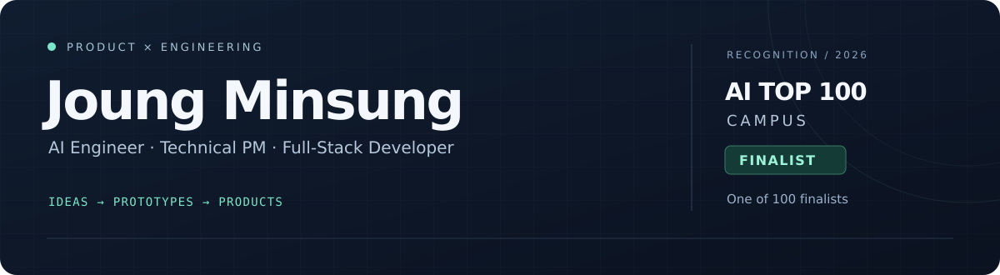
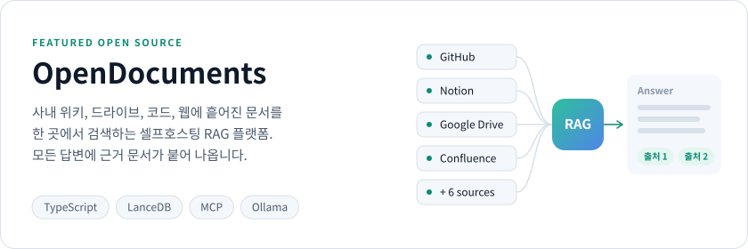
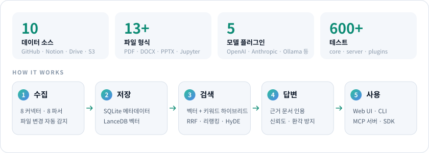
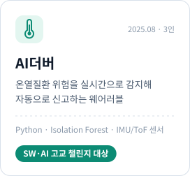
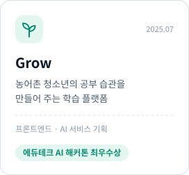
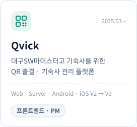
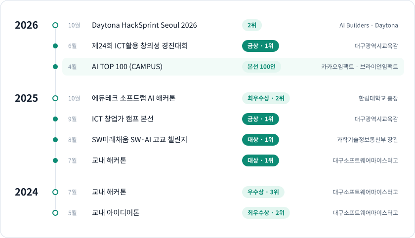
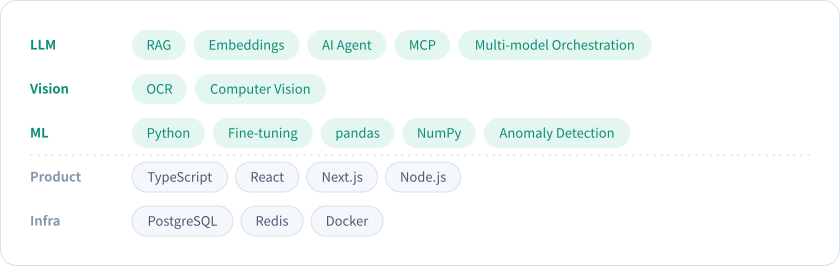

<p align="center">
  
</p>

<p align="center">
  <a href="mailto:joungminsung080830@gmail.com">Email</a>&nbsp;&nbsp;·&nbsp;&nbsp;<a href="https://github.com/joungminsung?tab=repositories">Repositories</a>
</p>

<br>

"가능할까요?"라고 묻기보다 "구현해봤습니다"라고 답하는 쪽을 좋아합니다.

기획부터 프론트엔드, 백엔드, AI 모델 연동까지 직접 붙여서 실제로 써볼 수 있는 첫 버전을 빠르게 내놓습니다.
요즘은 모델 파인튜닝과 OCR 같은 Vision AI를 다루고 있고, AI 에이전트와 RAG도 꾸준히 만들고 있어요.

<br>

## 오픈소스

<a href="https://github.com/joungminsung/OpenDocuments">
  <picture>
    <source media="(prefers-color-scheme: dark)" srcset="./assets/opendocuments-dark.svg" />
    
  </picture>
</a>

<p>
  <a href="https://github.com/joungminsung/OpenDocuments/stargazers"></a>
  <a href="https://www.npmjs.com/package/opendocuments"></a>
  
</p>

<picture>
  <source media="(prefers-color-scheme: dark)" srcset="./assets/opendocuments-inside-dark.svg" />
  
</picture>

```bash
npm install -g opendocuments
opendocuments init
opendocuments start   # http://localhost:3000
```

<br>

## 프로젝트

<p>
  <picture>
    <source media="(prefers-color-scheme: dark)" srcset="./assets/project-aidubber-dark.svg" />
    
  </picture>
  <picture>
    <source media="(prefers-color-scheme: dark)" srcset="./assets/project-grow-dark.svg" />
    
  </picture>
  <a href="https://qvick.xyz">
    <picture>
      <source media="(prefers-color-scheme: dark)" srcset="./assets/project-qvick-dark.svg" />
      
    </picture>
  </a>
</p>

<sub>Qvick 소스는 개발 동아리 <a href="https://github.com/Team-C0nnect">Team-C0nnect</a>에서 볼 수 있어요.</sub>

<br>

## 수상

<picture>
  <source media="(prefers-color-scheme: dark)" srcset="./assets/awards-dark.svg" />
  
</picture>

<sub>[AI TOP 100 (CAMPUS)](https://www.kakaocorp.com/page/detail/11978)는 학생 약 3,000명이 참가한 온라인 예선을 거쳐 100명이 본선에 올랐습니다.</sub>

<br>

## 기술

<picture>
  <source media="(prefers-color-scheme: dark)" srcset="./assets/stack-dark.svg" />
  
</picture>

<br>

<details>
<summary><b>활동과 자격</b></summary>
<br>

- 대구소프트웨어마이스터고 제10기 학생회 <sub>2025.08 –</sub>
- 새로 개설된 교육 창체 동아리 Louter 부장 <sub>2025.03 –</sub>
- 개발 동아리 c0nnect 2기 부장, Qvick 개발 <sub>2024.03 –</sub>
- 대구대학교 정보보호영재교육원 12기 고등 전문과정 수료 <sub>2025</sub>
- 해커톤 참가: 경기 기후 바이브코딩 해커톤, 제12회 SW 융합 해커톤, 유슬래시 U/THON 25, 해커그라운드 in 의성
- TOPCIT 2수준 (370점), AI 코딩활용능력 1급

</details>

<br>

<p align="center">
  <sub>같이 만들 게 있다면 <a href="mailto:joungminsung080830@gmail.com">joungminsung080830@gmail.com</a></sub>
</p>
